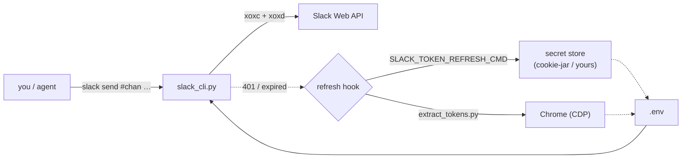

# slack-tools

> Agent-friendly Slack CLI built on browser tokens (`xoxc`/`xoxd`) — works as a
> **user**, not a bot. URL-first input, terse `key=value`/JSON output, Block Kit
> tables, mermaid→PNG, and a pluggable token-refresh hook.

[](https://github.com/AnatoliBu/slack-tools/actions/workflows/tests.yml)
[](LICENSE)
[](https://www.python.org/)
[](CONTRIBUTING.md)

Designed to be driven by both humans and LLM agents: every command takes a Slack
URL or `#channel`/`@user`/`C-id`, prints minimal machine-parsable output, and
auto-refreshes expired tokens via a hook you control.



## Contents

- [Install](#install)
- [Authenticate](#authenticate)
- [Usage](#usage)
- [Agent-friendly notes](#agent-friendly-notes)
- [Docs](#docs)
- [Token refresh hook](#token-refresh-hook)
- [Tests](#tests)
- [Contributing](#contributing) · [License](#license)

## Install

```bash
pip install -r requirements.txt          # slack_sdk (+ websockets for the extractor)
cp .env.example .env                      # then fill in tokens / workspace
export SLACK_WORKSPACE_URL=https://your-workspace.slack.com
```

Python 3.11+ (uses `tomllib`, modern typing). Symlink/alias `slack_cli.py` as `slack`.

## Authenticate

The CLI reads `xoxc`/`xoxd` from `.env` (gitignored) or the environment:

```
SLACK_XOXC="xoxc-..."
SLACK_XOXD="xoxd-..."
```

Get them automatically with the bundled extractor (opens Chrome via CDP, you log in
once, the profile persists):

```bash
python extract_tokens.py https://your-workspace.slack.com   # writes .env
```

> Browser tokens act **as your user**. They expire on Slack logout — re-run the
> extractor or wire the [refresh hook](#token-refresh-hook).

## Usage

```bash
slack send #general "hello"                     # post to channel (notifies your DM)
slack reply <URL> "in-thread reply"
slack read <URL>                                # one message / thread (Block Kit tables rendered)
slack read #general --limit 20                  # channel history
slack read <URL> --json                         # raw API JSON (flag works before OR after subcommand)
slack search "query" --in #general --from @user --after 2026-01-01
slack upload #general a.png b.png --comment "two files, one post"
slack download <F-id> -o ./out.png
slack files <URL> --thread --download ./dir
slack forward <URL> #other --comment "fyi"      # re-share (permalink + unfurl preview)
slack send #general "standup" --schedule 2026-07-20T09:00   # chat.scheduleMessage
slack scheduled #general                        # list scheduled; --cancel <id> to drop
slack members #general                           # <user-id> <name> per line
slack pin <URL> / slack unpin <URL>              # pins.add / pins.remove
slack join #general / slack leave #general
slack stats #general --top 5                     # top senders, per-day, files/reactions
slack wait #general --timeout 120                # block for a new message (exit 3 = timeout)
slack listen #general                            # NDJSON stream of new msgs (polling; no RTM)
slack table #general @rows.tsv --align l,c,r    # Block Kit table from TSV
slack md #general @report.md                    # markdown; ```mermaid``` fences → PNG
slack channels --filter eng                     # discovery
slack me                                         # whoami
```

> `wait`/`listen` poll `conversations.history` — browser (`xoxc`) tokens can't use
> RTM/Socket Mode, so there's no true streaming.

Run any subcommand with `-h` for full flags. Full reference → [docs/commands.md](docs/commands.md).

## Agent-friendly notes

- **URL-first**: paste any Slack archive URL into `read`/`reply`/`edit`/`delete`/`react`;
  channel + ts + thread are parsed for you.
- **Output**: default `key=value` lines (stable, greppable); `--json` for raw API.
- **Paths**: MSYS/WSL forms (`/c/Users/..`, `/mnt/c/..`, `/tmp/..`) are normalized
  automatically — no need to hand-feed Windows `C:/` paths.
- **No silent truncation**: `read` warns on stderr when output hit `--limit`.
- **⚠ No re-attach**: Slack can't attach a file to an already-sent message. Post the
  file *with* `--comment` in one call instead of text-then-file.

## Docs

- [docs/commands.md](docs/commands.md) — full command + flag reference, target resolution.
- [docs/block-kit.md](docs/block-kit.md) — mrkdwn rules, tables, markdown/mermaid→PNG, raw blocks, pitfalls.
- [docs/agent-guide.md](docs/agent-guide.md) — I/O contract, posting discipline, search semantics, auth model.

## Token refresh hook

On `401`/expiry the CLI tries, in order:

1. **`$SLACK_TOKEN_REFRESH_CMD`** — any command that rewrites `.env` with fresh
   tokens. Wire your own secret store / browser flow here. For fully hands-off
   refresh, pair it with [🍪 cookie-jar](https://github.com/AnatoliBu/cookie-jar) — a
   browser extension that keeps `xoxc`/`xoxd` synced into a secret store while you stay
   logged into Slack in Chrome:
   ```
   SLACK_TOKEN_REFRESH_CMD="python /path/to/cookie-jar/refresh_env.py .env SLACK_XOXC=slack/xoxc SLACK_XOXD=slack/xoxd"
   ```
2. **`extract_tokens.py`** — the bundled browser extractor (uses `$SLACK_WORKSPACE_URL`).
3. otherwise a clear error telling you to set tokens.

## Tests

```bash
python test_win_path.py       # path normalization (10)
python test_read_render.py    # table render, --json placement, multi-file upload (8)
python test_commands.py       # forward/members/pin/join/schedule/stats/wait/listen (21)
```

No pytest required — each file runs standalone (exit 0 = pass) and in CI on every push.

## Contributing

See [CONTRIBUTING.md](CONTRIBUTING.md). Issues and small, focused PRs welcome.

## License

[MIT](LICENSE).
